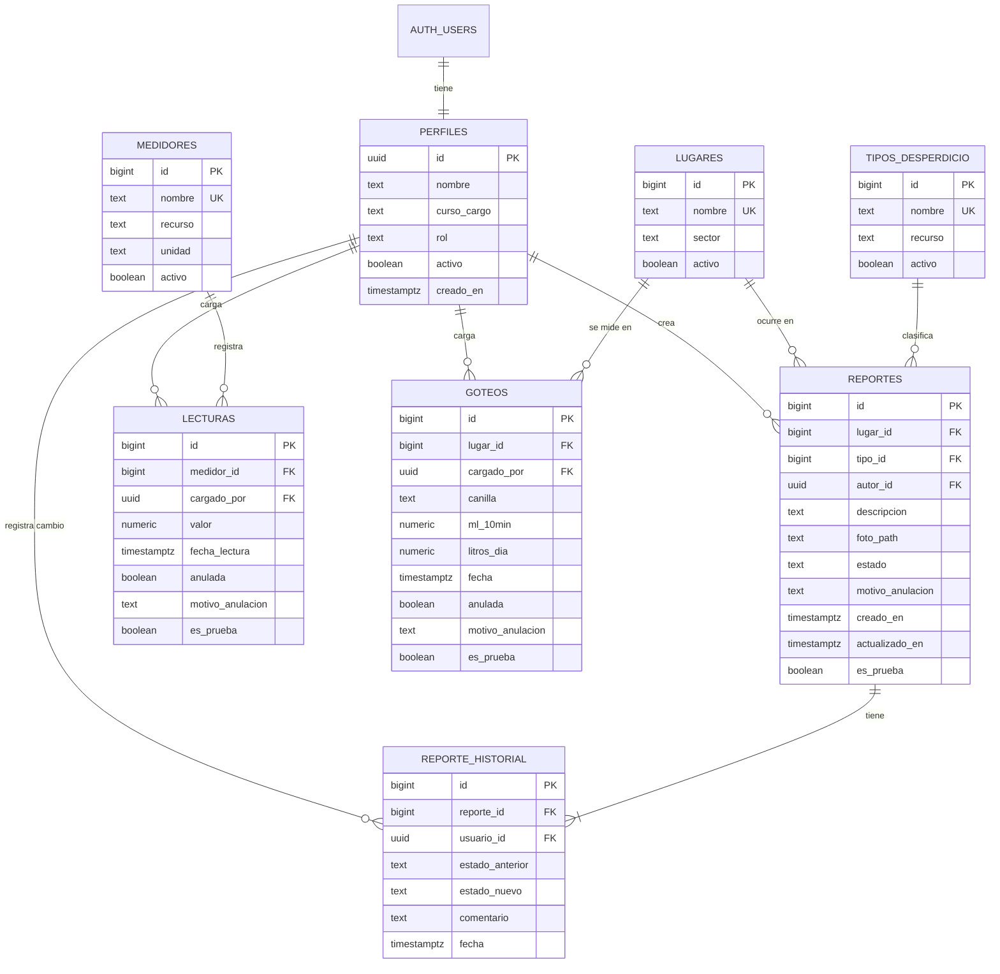

# GotaWatt · Etapa 6: base de datos e integración con Supabase

En esta etapa se diseñó la base de datos relacional del sistema, se implementó en Supabase y se conectó con la aplicación Vue.js, reemplazando los datos de prueba por información real, con autenticación y permisos por rol.

---

## 1. Revisión del análisis de datos (Etapa 3)

Se revisaron las entidades definidas en la Etapa 3 y se comprobó que cada funcionalidad tenga dónde guardar su información.

| Entidad | Atributos principales | Se relaciona con | Funcionalidad que la usa |
|---|---|---|---|
| Usuario (perfil) | nombre, curso o cargo, rol, activo | reportes, historial, lecturas, goteos | Ingreso, roles, habilitación de cuentas |
| Lugar | nombre, sector, activo | reportes, goteos | Formulario de reporte, goteo, estadísticas por sector |
| Tipo de desperdicio | nombre, recurso (agua o luz), activo | reportes | Formulario de reporte, filtros por recurso |
| Medidor | nombre, recurso, unidad, activo | lecturas | Carga de lecturas, consumo semanal |
| Reporte | lugar, tipo, descripción, foto, estado, motivo de anulación, autor, fechas | lugar, tipo, usuario, historial | Reportes, panel, estadísticas |
| Historial del reporte | estado anterior, estado nuevo, comentario, usuario, fecha | reporte, usuario | Detalle del reporte, tiempo de resolución |
| Lectura | medidor, valor, fecha, quién la cargó, anulada, motivo | medidor, usuario | Mediciones, panel, estadísticas |
| Goteo | lugar, canilla, ml en 10 minutos, litros por día, fecha, quién lo cargó | lugar, usuario | Mediciones, estadísticas |

**Cambios respecto de la Etapa 3**

- Se separó **Historial del reporte** en su propia tabla para no perder quién cambió cada estado y cuándo.
- Lugar, tipo de desperdicio y medidor pasaron a ser **tablas de catálogo** en lugar de texto libre, para evitar que el mismo lugar se escriba de formas distintas («Baño 2», «baño 2do piso»).
- Se agregó el campo `es_prueba` en reportes, lecturas y goteos para distinguir los datos simulados de los reales.
- Se agregó el campo `activo` en los catálogos para poder darlos de baja sin borrar el historial.

## 2. Diagrama Entidad-Relación (DER)

**Cardinalidades**

| Relación | Cardinalidad | Lectura |
|---|---|---|
| Cuenta (auth.users) – Perfil | 1 a 1 | Cada cuenta de Supabase tiene exactamente un perfil |
| Perfil – Reporte | 1 a N | Un usuario crea muchos reportes; cada reporte tiene un autor |
| Lugar – Reporte | 1 a N | En un lugar puede haber muchos reportes; cada reporte es de un lugar |
| Tipo – Reporte | 1 a N | Un tipo clasifica muchos reportes; cada reporte tiene un tipo |
| Reporte – Historial | 1 a N (al menos 1) | Cada reporte tiene una o más filas de historial (la primera es «creado») |
| Perfil – Historial | 1 a N | Un usuario registra muchos cambios de estado |
| Medidor – Lectura | 1 a N | Un medidor tiene muchas lecturas; cada lectura es de un medidor |
| Perfil – Lectura | 1 a N | Un usuario carga muchas lecturas |
| Lugar – Goteo | 1 a N | En un lugar se miden muchas canillas |
| Perfil – Goteo | 1 a N | Un usuario carga muchas mediciones de goteo |

**Relación de muchos a muchos resuelta:** entre **Perfil** y **Reporte** existe una relación N a M además de la de autoría: un usuario cambia el estado de muchos reportes y un reporte es modificado por muchos usuarios (el socio que lo crea, mantenimiento que lo repara, el administrador que lo reabre). Se resolvió con la tabla intermedia **`reporte_historial`**, que guarda además los datos propios de cada cambio (estado anterior, estado nuevo, comentario y fecha).

## 3. Modelo relacional

Notación: **PK** = clave primaria, **FK** = clave foránea, **UK** = valor único. «Sí» en *Oblig.* significa `NOT NULL`.

### `perfiles`
| Campo | Tipo | Clave | Oblig. | Restricciones |
|---|---|---|---|---|
| id | uuid | PK, FK → auth.users.id | Sí | Se borra si se borra la cuenta (`on delete cascade`) |
| nombre | text | | Sí | Entre 2 y 80 caracteres |
| curso_cargo | text | | No | Hasta 40 caracteres |
| rol | text | | Sí | `administrador`, `socio`, `docente` o `mantenimiento`. Por defecto `socio` |
| activo | boolean | | Sí | Por defecto `false`: el administrador habilita la cuenta |
| creado_en | timestamptz | | Sí | Por defecto la fecha actual |

### `lugares`
| Campo | Tipo | Clave | Oblig. | Restricciones |
|---|---|---|---|---|
| id | bigint (identity) | PK | Sí | Autoincremental |
| nombre | text | UK | Sí | Entre 2 y 60 caracteres, no se repite |
| sector | text | | Sí | `aula`, `baño`, `laboratorio`, `cocina`, `patio`, `oficina` u `otro` |
| activo | boolean | | Sí | Por defecto `true`. No se puede dar de baja si tiene reportes abiertos |

### `tipos_desperdicio`
| Campo | Tipo | Clave | Oblig. | Restricciones |
|---|---|---|---|---|
| id | bigint (identity) | PK | Sí | Autoincremental |
| nombre | text | UK | Sí | Entre 3 y 60 caracteres, no se repite |
| recurso | text | | Sí | `agua` o `luz` |
| activo | boolean | | Sí | Por defecto `true`. No se puede dar de baja si tiene reportes abiertos |

### `medidores`
| Campo | Tipo | Clave | Oblig. | Restricciones |
|---|---|---|---|---|
| id | bigint (identity) | PK | Sí | Autoincremental |
| nombre | text | UK | Sí | Entre 3 y 60 caracteres, no se repite |
| recurso | text | | Sí | `agua` o `luz` |
| unidad | text | | Sí | `kWh` o `m3`. Luz siempre en kWh y agua siempre en m³ |
| activo | boolean | | Sí | Por defecto `true` |

### `reportes`
| Campo | Tipo | Clave | Oblig. | Restricciones |
|---|---|---|---|---|
| id | bigint (identity) | PK | Sí | Autoincremental |
| lugar_id | bigint | FK → lugares.id | Sí | El lugar tiene que estar activo |
| tipo_id | bigint | FK → tipos_desperdicio.id | Sí | El tipo tiene que estar activo |
| descripcion | text | | No | Hasta 300 caracteres |
| foto_path | text | | No | Ruta de la foto en Storage (bucket `fotos`) |
| estado | text | | Sí | `pendiente`, `en_reparacion`, `resuelto` o `anulado`. Por defecto `pendiente` |
| motivo_anulacion | text | | No* | Hasta 200 caracteres. *Obligatorio si el estado es `anulado` |
| autor_id | uuid | FK → perfiles.id | Sí | Por defecto el usuario que inicia sesión (`auth.uid()`) |
| creado_en | timestamptz | | Sí | Por defecto la fecha actual |
| actualizado_en | timestamptz | | Sí | Lo actualiza un trigger en cada cambio |
| es_prueba | boolean | | Sí | Por defecto `false` |

Índice único parcial: no puede haber dos reportes **abiertos** (pendiente o en reparación) con el mismo `lugar_id` y `tipo_id`.

### `reporte_historial`
| Campo | Tipo | Clave | Oblig. | Restricciones |
|---|---|---|---|---|
| id | bigint (identity) | PK | Sí | Autoincremental |
| reporte_id | bigint | FK → reportes.id | Sí | Se borra junto con el reporte (solo pasa con datos de prueba) |
| estado_anterior | text | | No | Vacío en la fila de creación |
| estado_nuevo | text | | Sí | |
| comentario | text | | No | Guarda el motivo cuando se anula |
| usuario_id | uuid | FK → perfiles.id | No | Quién hizo el cambio |
| fecha | timestamptz | | Sí | Por defecto la fecha actual |

Solo la escribe la base de datos (trigger `registrar_historial`); ningún usuario puede insertar, modificar ni borrar filas.

### `lecturas`
| Campo | Tipo | Clave | Oblig. | Restricciones |
|---|---|---|---|---|
| id | bigint (identity) | PK | Sí | Autoincremental |
| medidor_id | bigint | FK → medidores.id | Sí | El medidor tiene que estar activo |
| valor | numeric(12,2) | | Sí | Entre 0 y 9.999.999,99. No puede ser menor que la lectura anterior |
| fecha_lectura | timestamptz | | Sí | Por defecto la fecha actual |
| cargado_por | uuid | FK → perfiles.id | Sí | Por defecto el usuario que inicia sesión |
| anulada | boolean | | Sí | Por defecto `false` |
| motivo_anulacion | text | | No* | *Obligatorio si `anulada` es verdadero |
| es_prueba | boolean | | Sí | Por defecto `false` |

Índice único parcial: una sola lectura válida por medidor y por día.

### `goteos`
| Campo | Tipo | Clave | Oblig. | Restricciones |
|---|---|---|---|---|
| id | bigint (identity) | PK | Sí | Autoincremental |
| lugar_id | bigint | FK → lugares.id | Sí | El lugar tiene que estar activo |
| canilla | text | | Sí | Entre 1 y 40 caracteres |
| ml_10min | numeric(8,1) | | Sí | Mayor que 0 y hasta 5000 |
| litros_dia | numeric(10,2) | | Sí | **Calculado** por la base: `ml_10min × 144 / 1000` |
| fecha | timestamptz | | Sí | Por defecto la fecha actual |
| cargado_por | uuid | FK → perfiles.id | Sí | Por defecto el usuario que inicia sesión |
| anulada | boolean | | Sí | Por defecto `false` |
| motivo_anulacion | text | | No* | *Obligatorio si `anulada` es verdadero |
| es_prueba | boolean | | Sí | Por defecto `false` |

### Vistas (consultas guardadas, no son tablas)
| Vista | Qué muestra |
|---|---|
| `reportes_detalle` | Cada reporte con el nombre del lugar, el tipo, el recurso y el autor (une 4 tablas) |
| `resumen_por_lugar` | Cantidad de reportes de cada lugar por estado |

Las dos usan `security_invoker`, así que respetan los permisos de quien las consulta.

## 4. Normalización

- **Primera forma normal (1FN):** todos los campos guardan un solo valor. No hay listas dentro de un campo: los cambios de estado de un reporte están en filas separadas de `reporte_historial` y no en un texto acumulado.
- **Segunda forma normal (2FN):** todas las tablas tienen una clave primaria simple (`id`), por lo que cada atributo depende de la clave completa.
- **Tercera forma normal (3FN):** no hay atributos que dependan de otro atributo que no sea la clave. Por ejemplo, el nombre del lugar, el recurso del tipo o el nombre del autor **no se copian** en `reportes`: se obtienen con JOIN mediante las claves foráneas. Si se corrige el nombre de un lugar, el cambio se ve en todos sus reportes.

**Decisiones conscientes**

| Caso | Por qué se dejó así |
|---|---|
| `goteos.litros_dia` es un dato derivado | Es una columna **calculada por la base** (`generated always`): nadie la puede escribir, así que nunca queda inconsistente con `ml_10min`. Ahorra repetir la cuenta en cada consulta. |
| `medidores.unidad` depende de `recurso` | Una restricción `check` obliga a que luz sea kWh y agua sea m³, así que no puede haber combinaciones inválidas. Se guarda para mostrar la unidad sin cálculos. |
| `reportes.estado` y `motivo_anulacion` | El estado actual se guarda en el reporte para filtrar rápido; el historial completo está en `reporte_historial`. Un trigger mantiene las dos cosas sincronizadas. |

## 5. Proyecto en Supabase

| Dato | Valor |
|---|---|
| Nombre del proyecto | **GotaWatt** |
| Propósito | Backend del sistema de la Cooperativa Escolar GotaWatt para registrar desperdicios de agua y energía, mediciones de consumo y su seguimiento. |
| Servicios usados | Base de datos PostgreSQL, Auth (correo y contraseña), Storage (fotos) y Realtime (actualización automática de pantallas) |

**Cómo está organizada la base de datos**

- **Esquema `public`:** las 8 tablas del sistema, las 2 vistas, las funciones de permisos y los triggers con las reglas de negocio.
- **Esquema `auth`** (lo maneja Supabase): las cuentas de usuario. Cada cuenta nueva crea su fila en `perfiles` mediante el trigger `al_registrarse`.
- **Storage:** bucket privado `fotos`, con una carpeta por usuario (`<id del usuario>/<fecha>.jpg`), límite de 2 MB y solo imágenes JPG, PNG o WEBP.

## 6. Scripts SQL

Todo el código SQL está en la carpeta [`supabase/`](../supabase) para poder reproducir la base desde cero:

| Archivo | Contenido | Cuándo se ejecuta |
|---|---|---|
| `01_estructura.sql` | Tablas, claves primarias y foráneas, restricciones, índices, triggers y la vista `reportes_detalle` | Primero |
| `02_politicas.sql` | Row Level Security, políticas por rol, permisos de tabla y bucket de fotos | Segundo |
| `00_primer_administrador.sql` | Convierte la primera cuenta en administrador | Después de crear la cuenta desde la app |
| `03_datos_prueba.sql` | Catálogos de la escuela y registros ficticios | Después del administrador |
| `04_reglas_negocio.sql` | Reglas de la versión 2, vista `resumen_por_lugar` y Realtime | Después de 02 (en cualquier momento) |
| `05_consultas_prueba.sql` | Consultas de selección, inserción, actualización, eliminación y JOIN | Para comprobar el funcionamiento |
| `06_pruebas_permisos.sql` | Prueba automática de permisos y reglas, simulando cada rol | Para comprobar la seguridad |

## 7. Datos de prueba

`03_datos_prueba.sql` carga 14 lugares, 8 tipos de desperdicio, 2 medidores, 10 reportes en distintos estados (con su historial), 5 lecturas semanales por medidor y 3 mediciones de goteo. Son **ficticios**, respetan todas las relaciones y restricciones y quedan marcados con `es_prueba = true`, por lo que la app los muestra con la etiqueta «Prueba» y el administrador los puede eliminar. El script se puede volver a ejecutar: primero borra los datos de prueba anteriores.

## 8. Consultas de comprobación

`05_consultas_prueba.sql` contiene:

- **Selección:** lugares activos, reportes abiertos, goteos con más pérdida.
- **JOIN:** reportes con lugar, tipo y autor (4 tablas); historial con el nombre de quien hizo cada cambio; reportes por sector y recurso (JOIN + GROUP BY); consumo semanal por medidor; lugares sin reportes (LEFT JOIN); tiempo promedio de resolución por tipo.
- **Inserción, actualización y eliminación:** alta de un lugar y un reporte, cambio de estado (se ve la fila nueva del historial), anulación de una lectura y eliminación de datos de prueba. Todo dentro de una transacción con `ROLLBACK`.
- **Restricciones que tienen que fallar:** goteo fuera de rango, anulación sin motivo, lugar repetido, reporte abierto duplicado y lectura menor a la anterior.

Los resultados están en [pruebas.md](pruebas.md).

## 9. Seguridad: Row Level Security (RLS)

RLS está habilitado en las 8 tablas. Los permisos dependen del rol guardado en `perfiles` y solo valen para cuentas **activas** (funciones `rol_actual()` y `usuario_activo()`).

| Tabla | Ver | Crear | Modificar | Eliminar |
|---|---|---|---|---|
| lugares, tipos, medidores | Usuarios activos | Administrador | Administrador | Administrador |
| perfiles | El propio y, si está activo, los demás | Nadie (lo crea el trigger de registro) | Administrador (no puede cambiar su propio rol) | Nadie |
| reportes | Usuarios activos | Administrador y socio, a su nombre y en estado pendiente | Administrador; mantenimiento (solo estado); socio (sus pendientes) | Administrador, solo datos de prueba |
| reporte_historial | Usuarios activos | Nadie (lo escribe un trigger) | Nadie | Nadie |
| lecturas, goteos | Usuarios activos | Administrador y socio, a su nombre | Administrador (anular) | Administrador, solo datos de prueba |
| fotos (Storage) | Usuarios activos | Administrador y socio, solo en su carpeta | — | — |

Además de las políticas, el trigger `controlar_reporte` revisa **qué campos** puede cambiar cada rol y que el **orden de estados** sea válido. El público sin sesión (`anon`) no tiene acceso a ninguna tabla.

Para verificar que un usuario no pueda ver ni modificar lo que no le corresponde se preparó `06_pruebas_permisos.sql`, que simula cada rol y prueba 39 casos (resultados en [pruebas.md](pruebas.md)).

## 10. Autenticación con Supabase Auth

- **Registro:** pantalla «Crear cuenta» con nombre, curso o cargo, correo y contraseña (mínimo 8 caracteres). Si Supabase lo pide, se confirma el correo.
- **Perfil y rol:** al registrarse, el trigger `al_registrarse` crea el perfil con rol `socio` e **inactivo**. La persona ve la pantalla «Cuenta pendiente» hasta que el administrador la habilita y le asigna el rol desde **Usuarios**.
- **Ingreso y cierre de sesión:** con correo y contraseña; el botón «Salir» cierra la sesión. Si la sesión se cierra o vence, la app vuelve a la pantalla de ingreso.
- **Primer administrador:** se crea con `00_primer_administrador.sql` (ninguna cuenta puede hacerse administradora sola).

## 11. Conexión de Vue.js con Supabase

- Dependencia: `@supabase/supabase-js`.
- Archivo de configuración: [`src/services/supabase.js`](../src/services/supabase.js), que crea el cliente.
- Variables de entorno en `.env` (`VITE_SUPABASE_URL` y `VITE_SUPABASE_ANON_KEY`). El archivo `.env` está en `.gitignore`; en el repositorio solo está `.env.example` vacío.
- Solo se usa la clave pública `anon`. La clave `service_role` y las contraseñas no aparecen en el código ni en la documentación.

## 12. Reemplazo de los datos de prueba

Las pantallas no leen datos directamente: llaman a [`src/services/api.js`](../src/services/api.js), que usa [`apiSupabase.js`](../src/services/apiSupabase.js) cuando hay `.env` y [`apiDemo.js`](../src/services/apiDemo.js) (modo demostración) cuando no lo hay. Así, los datos de la Etapa 5 se reemplazaron por consultas reales sin cambiar las vistas. Se comprobó que panel, reportes, detalle, mediciones, estadísticas y usuarios muestran la información de las tablas.

## 13. Operaciones CRUD

| Entidad | Crear | Leer | Actualizar | Eliminar |
|---|---|---|---|---|
| **Reportes** (principal) | Formulario «Nuevo reporte» con foto | Listado con filtros y detalle con historial | «Editar datos» y cambio de estado | Anulación (baja lógica) y eliminación de datos de prueba |
| Lugares, tipos, medidores | Pantalla «Catálogos» | Pantalla «Catálogos» | Pantalla «Catálogos» | Dar de baja / reactivar (baja lógica) |
| Lecturas y goteos | Formularios de Mediciones | Tablas de Mediciones | Anulación por el administrador | Baja lógica (anulación con motivo) |
| Usuarios | Registro | Pantalla «Usuarios» | Rol y habilitación | Deshabilitar (baja lógica) |

## 14. Formularios conectados

Todos los formularios validan antes de enviar ([`src/utils/validaciones.js`](../src/utils/validaciones.js)) y la base de datos vuelve a controlar las mismas reglas. Cada operación muestra un mensaje de confirmación («Reporte enviado», «Lectura guardada») o de error con una explicación clara (por ejemplo, «Un medidor no retrocede: la lectura anterior fue 18.040»).

## 15. Consultas y filtros

- **Reportes:** búsqueda por texto (lugar, tipo, descripción o autor), estado, lugar, recurso, «solo mis reportes» y orden (más recientes, más antiguos, últimos actualizados, lugar).
- **Mediciones:** filtro por medidor o por lugar y opción de ver las anuladas.
- **Usuarios:** búsqueda por nombre o curso, filtro por rol y por estado.
- **Catálogos:** búsqueda por nombre y opción de ver los dados de baja.
- **Estadísticas:** consumo semanal, reportes por sector, por estado y lugares con más reportes.

Como las consultas pasan por RLS, cada usuario solo recibe lo que su rol le permite ver.

## 16 y 17. Pruebas

Ver [pruebas.md](pruebas.md): pruebas de base de datos, de permisos, de funcionamiento en la app y de integración, con pasos, resultado esperado, resultado obtenido y errores corregidos.

## 18. Coherencia con las etapas anteriores

- Las tablas cubren todas las historias de usuario de la versión 1 (reportar, reparar, medir, consultar y administrar).
- Los cuatro roles de la Etapa 3 coinciden con los valores de `perfiles.rol` y con las políticas RLS.
- Las reglas de negocio de la Etapa 3 (no borrar datos reales, orden de estados, el medidor no retrocede, motivo obligatorio al anular) están implementadas en la base de datos y repetidas en la interfaz.
- **Pendiente de implementar:** reporte anónimo con código QR para la comunidad, encuestas, inventario y préstamo de equipos, informe en PDF y aprobación de informes por el docente.
